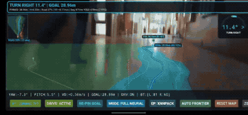

# Autonomous Mobile Robot (AMR) — Public Architectural Summary

> **Note on Proprietary Components**: This repository provides the basic structural code, hardware interfaces, Android/ESP32/Python project skeletons, and high-level logic descriptions for the 4WD skid-steer autonomous robot system. Proprietary neural network architectures, custom model weights, scene alignment routines, visual-inertial odometry estimation, traversability scoring, and path optimization methods have been intentionally removed.

## Indoor Test Demo

---

## Architectural Foundations `(presented in ECSA-13 paper)`

Several core architectural principles used in this system build directly upon the embedded multi-sensor perception and state-driven safety framework **(presented in ECSA-13 paper)**:

1. **State-Driven System Controller & Resource Contention Prevention** *(presented in ECSA-13 paper)*:
   - Coordinates operational mode transitions (`FORWARD_MODE`, paused/standby, and hazard states), releasing capture/inference queues cleanly during state changes so concurrent modules do not contend for hardware resources.
2. **Hybrid Classical + Deep-Learning Dual-Branch Perception** *(presented in ECSA-13 paper)*:
   - Combines a fast geometric/appearance surface branch for structured drivable-area estimation with a compact neural object-detection branch for variable foreground obstacles.
3. **Monocular Range Estimation, Trajectory Threat Analysis & Persistence-Gated Braking** *(presented in ECSA-13 paper)*:
   - Estimates obstacle distance from calibrated monocular camera geometry without LiDAR or radar, evaluates forward ego-corridor and lateral cut-in conflicts with discrete time-to-collision (TTC) surrogates, and applies persistence verification before issuing emergency stop commands.
4. **Background Sensor Diagnostics & H-Bridge Actuator Cutoff Interlock** *(presented in ECSA-13 paper)*:
   - Continuously monitors ambient light and proximity/health sensors across states, and enforces a hardware H-bridge drive cutoff upon safety triggers or communication timeout.

---

## High-Level AMR Extensions (Proprietary Details Omitted)

- **Clean-Road Segment Priority**: Traversable ground segmentation excludes non-road patches (including unrecognized low-profile objects), and route selection favors paths passing through larger contiguous clean road areas calibrated for the 350 mm × 380 mm 4WD chassis (camera height ~330 mm).
- **Local Goal Anchoring & Relative Tracking**: Supports local goal anchoring and continuous relative position tracking via onboard odometry.

---

## Folder Structure

- `python_backend/` — Sanitized Python perception, monocular range/threat controller, Wi-Fi server, and metadata export skeletons (`.py`, `.bat`).
- `AMRWaistNavigatorOffline/` — Sanitized Android on-device autonomous navigation & Bluetooth drive app skeleton (`.kt`, `.xml`, `.kts`).
- `AMRWaistNavigator/` — Sanitized Android Wi-Fi camera/IMU streaming client skeleton (`.kt`, `.xml`, `.kts`).
- `AMR_ESP32_Firmware/` — Sanitized ESP32 Bluetooth SPP + dual IBT-2 H-bridge motor controller skeleton (`.ini`, `.cpp`).
- `AMR_ESP32_IBT2_Wiring_Guide.md` — Physical dimensions and D-coded ESP32 DevKit V1 to dual IBT-2 wiring summary.
